# Nam Forge knob collection

A small collection of vector JUCE LookAndFeel models. The Boss family shares
[`BossKnobLookAndFeel.h`](../vst/Source/Knobs/BossKnobLookAndFeel.h); named
models are thin subclasses in [`vst/Source/Knobs`](../vst/Source/Knobs).

## Pointer rule

Every pointer, dot, stripe or index indicates the knob's position: it rotates
with the knob, points to 12 o'clock at centre and 7:30/4:30 at the extremes.
Pointers follow the **body/plinth** colour: warm white `#FFF8E8` on every body
colour except White and Cream, which use charcoal `#1B1B1B`. Inserts do not
change the pointer colour (the API body is black, so its dot stays white even
with a White/Cream insert). Metal-surface pointers are black `#111111` on
silver/aluminium and gold, and warm white `#FFF8E8` on brushed black.
Fender has no pointer; Chicken-Head's body is the pointer and its index line
follows the same rule. Full specification:
[test-plugin-style-guide.md](test-plugin-style-guide.md#pointers-and-indicators-must).

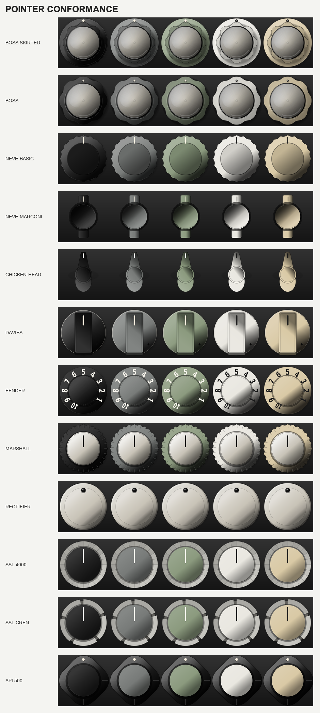

> **Rectifier update (2026-11-18):** the Rectifier is now skirtless brushed
> metal with a large dot indicator and a silver/gold/brushed-black metal palette.
> See [rectifier-knob.md](rectifier-knob.md); the Rectifier entry below uses the
> metal palette, not the plastic one.

| Model | Class | Description |
|---|---|---|
| Boss Skirted | `BossSkirtedLookAndFeel` | Fluted body on a wide gloss-plastic skirt — the reference reconstruction. |
| Boss | `BossLookAndFeel` | Same body and spun-aluminium cap with no skirt; the fluted body is the outer diameter. |
| Neve-Basic | `NeveBasicLookAndFeel` | Tall straight-sided knob with twenty fine flutes, a raised rim, a recessed top and a radial pointer. Straight-on view only. |
| Neve-Marconi | `NeveMarconiLookAndFeel` | Dark Marconi cap with a recessed centre and a wide pointer bar. No clear skirt or outer base. Straight-on view only. |
| Chicken-Head | `ChickenHeadLookAndFeel` | Asymmetric pointer knob with wide tail, tapered pointer and raised hub. |
| Davies | `DaviesLookAndFeel` | Circular base with a raised rectangular pointer bar, a longitudinal white pointer stripe at its outer end, and a set-screw hole. |
| Fender | `FenderLookAndFeel` | Numbered skirt and knurled top; text and pointer omitted. Numbers descend 10→1 left to right with 5 at top centre, full height, white except on White and Cream. |
| Marshall | `MarshallLookAndFeel` | Fluted black body with a spun-metal cap; pointer black on silver/gold, white on brushed black. |
| Rectifier | `RectifierLookAndFeel` | Skirtless brushed-metal body with a large dot indicator; black on silver/gold, white on brushed black; metal palette only. |
| SSL 4000 | `SSLLookAndFeel` | Thin segmented grey ring with a coloured insert and white pointer. |
| SSL Crenulated | `SSLCrenulatedLookAndFeel` | SSL body with five large raised grip sections and the same narrow recessed indents. |
| API 500 | `APILookAndFeel` | Black four-lobed body, one lobe larger, with a coloured insert and a Boss-style white position dot. |

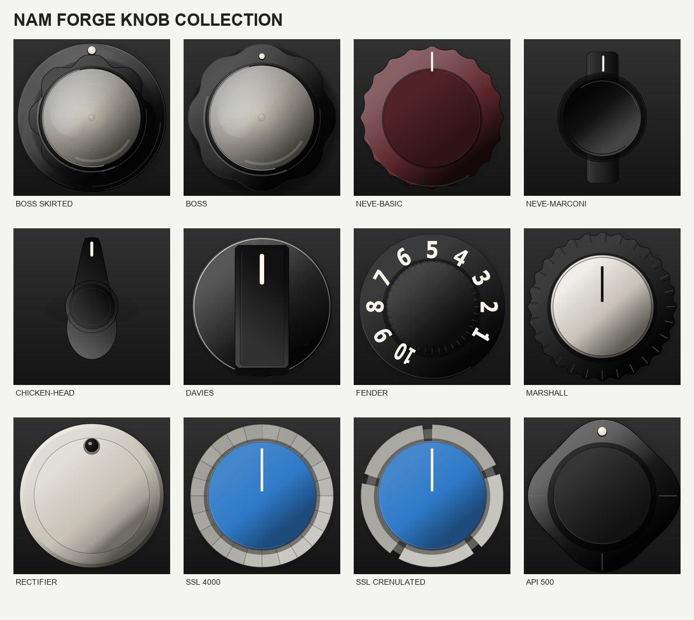

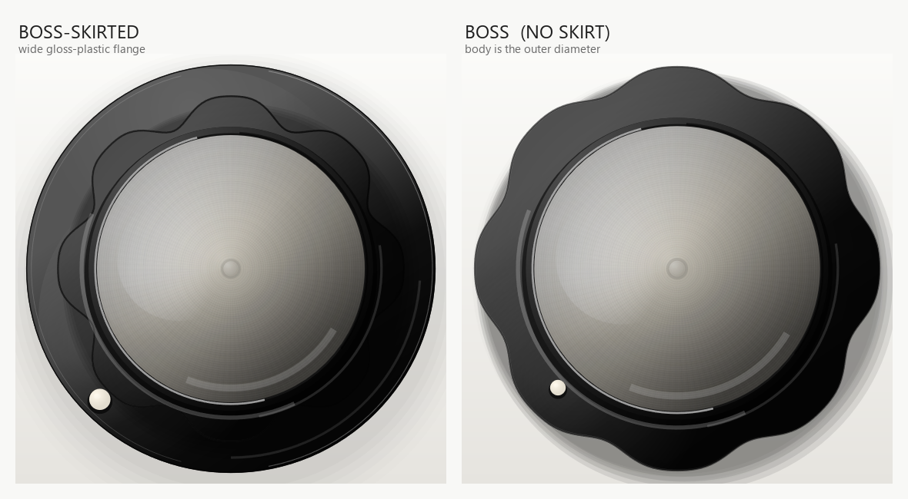

Both Boss models are shown at minimum, centre and maximum in the contact sheet:

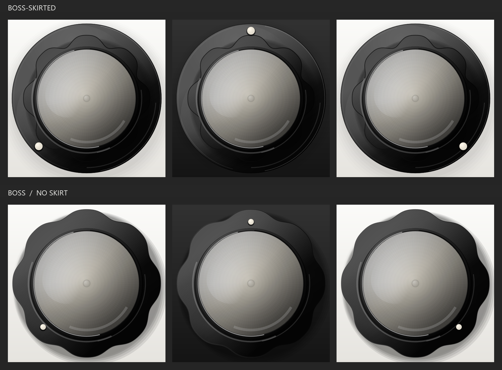

## Neve-Basic

[`NeveBasicLookAndFeel`](../vst/Source/Knobs/NeveBasicLookAndFeel.h) is the
straight-on reinterpretation of the MAF Audio plastic knob: a fluted cylinder
with a raised outer rim, recessed top and one radial pointer. It is axial only —
there is deliberately no three-quarter view.

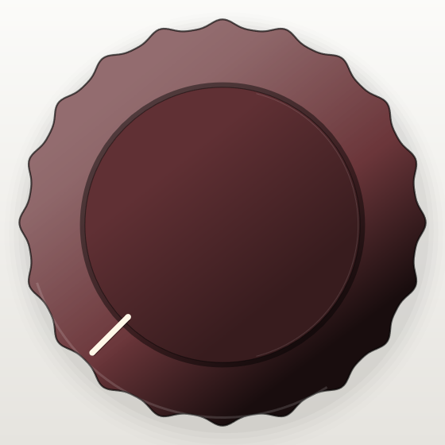

It uses the same plastic palettes and defaults to a Neve oxblood (`#6B363A`).
It has no metal cap.

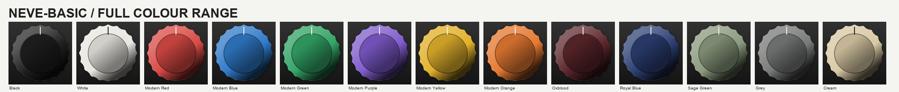

## Neve-Marconi

[`NeveMarconiLookAndFeel`](../vst/Source/Knobs/NeveMarconiLookAndFeel.h) is the
straight-on Marconi knob: a dark cap with a recessed centre and a wide pointer bar
with a white index inlay. There is no transparent skirt, no outer body disc and
no base — the bar wings are the widest part of the control.

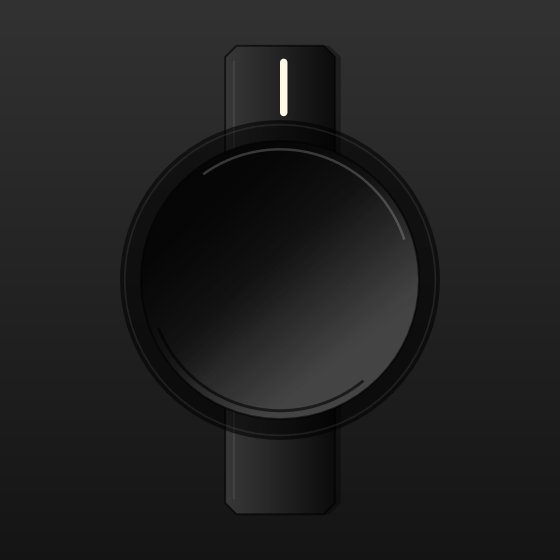

Black is the default. The plastic palette applies to the body, pointer bar and
cap:

```cpp
NeveMarconiLookAndFeel marconi;
marconi.setPlasticFinish (KnobFinish::modernRed);
```

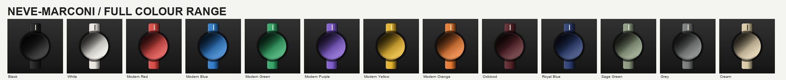

## Classic amp knobs

Five reference-derived models, all straight-on and palette-aware:

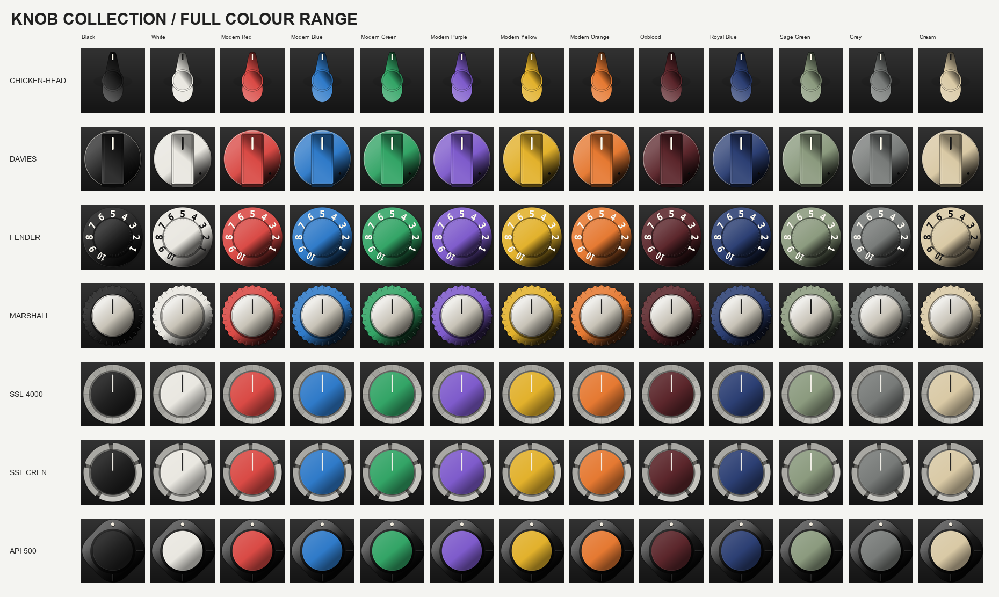

| Model | Notes | Full palette |
|---|---|---|
| Chicken-Head | Asymmetric pointer and wide tail | [chicken-head-palette.png](chicken-head-palette.png) |
| Davies | Raised rectangular pointer bar, longitudinal white pointer, set-screw hole | [davies-palette.png](davies-palette.png) |
| Fender | Numbers descend 10→1 left to right, with 5 at top centre; no text or pointer. Full-height white numbers, charcoal on White and Cream | [fender-palette.png](fender-palette.png) |
| Marshall | Fluted black body, spun-metal cap | [marshall-palette.png](marshall-palette.png) |
| Rectifier | Skirtless brushed-metal body, large dot indicator; metal palette only | [rectifier-metal-palette.png](rectifier-metal-palette.png) |

The Fender model keeps the numbered scale but omits all text and the pointer;
the numbers fill the skirt height, run 10→1 left to right, and centre **5** at
the top. Marshall also supports the brushed-metal finishes. Rectifier uses the
metal palette exclusively (silver, gold, brushed black); see
[rectifier-knob.md](rectifier-knob.md).

## Console knobs

Three straight-on console-style models:

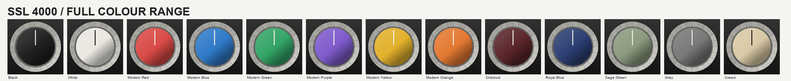

**SSL 4000** — thin segmented grey grip ring, raised coloured insert and a white
pointer line. The palette controls the insert; the ring stays grey.

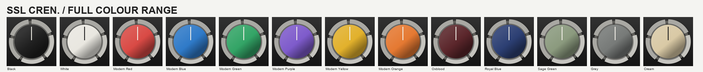

**SSL Crenulated** — the same SSL insert and pointer, with a skirt of five large
raised grip sections separated by narrow recessed indents.

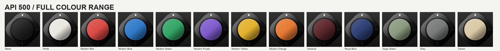

**API 500** — black four-lobed body with one slightly larger lobe, a coloured
insert and a Boss-style white position dot. There is no pointer line; the dot
sits on the knob's angle and provides the position reference. The palette
controls the insert; the body stays black.

SSL uses white pointer lines except on White and Cream, which switch to charcoal.

## Boss construction

| Part | Technique |
|---|---|
| Body | Eight-lobed contour from a two-harmonic radius function, with a radius and lobe depth selected by the model |
| Skirt | Only on Boss Skirted: gloss gradient, layered contact shadow, rolled outer lip and broad lower-left sheen |
| Cap | Spun aluminium: concentric brush rings, sunburst wedges, radial grain, key reflection, crescent and machined chamfer |
| Position | High-contrast dot on the skirt (Boss Skirted) or on the black top ring (Boss); white on dark plastic, charcoal on light plastic |
| Disabled | Whole knob at 52% opacity |

Boss Skirted supports two presentations:

- `Style::topDown` (default) — axial view for a flat rack/plugin panel.
- `Style::perspective` — three-quarter product-photo view.

Boss is intended for the flat-panel case, so it always renders axially.

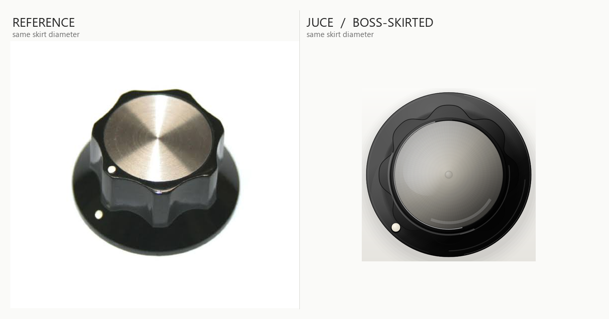

## Palettes

Black and White are common to both groups. The palettes live in
[`KnobColours.h`](../vst/Source/Knobs/KnobColours.h) as `KnobFinish` values and
are rendered with the same plastic shading.

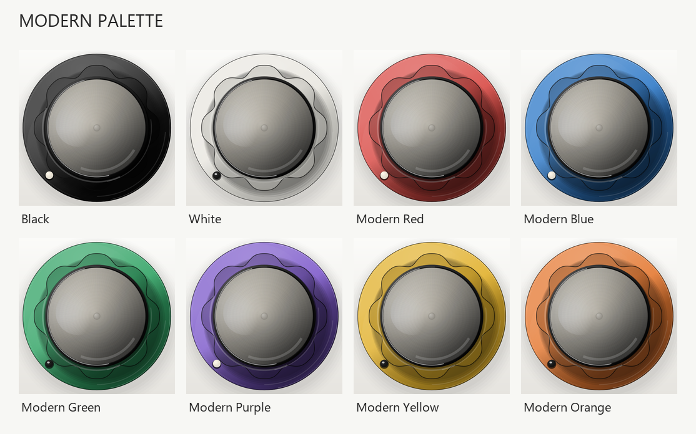

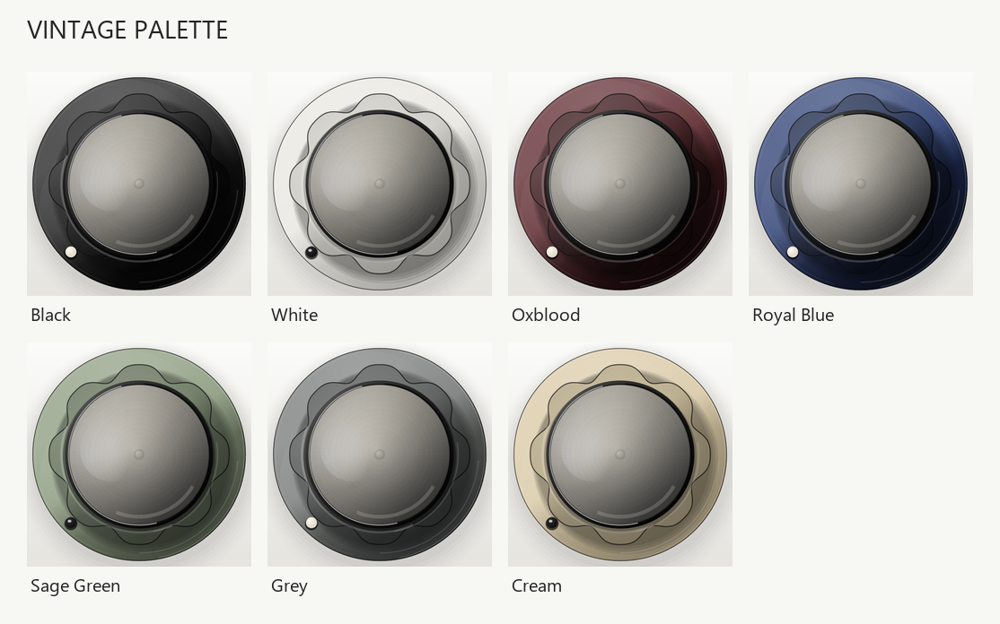

- **Modern:** Red `#D94A45`, Blue `#2F7AC8`, Green `#33A466`, Purple
  `#7E5BCB`, Yellow `#E2B12C`, Orange `#E57932`.
- **Vintage:** Oxblood `#5B262B`, Royal Blue `#2C3F73`, Sage Green `#8B9A7E`,
  Grey `#777A78`, Cream `#D9C9A5`.
- **Neutral:** Black `#202020`, White `#E9E7E0`.

Apply a finish directly:

```cpp
laf.setPlasticFinish (KnobFinish::modernBlue);
// or any juce::Colour:
laf.setPlasticColour (juce::Colour (0xff2f7ac8));
```

The renderer derives highlight and shadow shades from the base colour, reduces
the shadow contrast on light finishes, and switches the indicator dot from
off-white to charcoal when the plastic is light enough to need it. The metal cap
has its own finish set, described below.

For a selector UI, enumerate the groups directly:

```cpp
for (auto finish : getKnobPaletteFinishes (KnobPalette::modern))
    addSwatch (getKnobFinishName (finish), getKnobFinishColour (finish));

for (auto finish : getKnobPaletteFinishes (KnobPalette::vintage))
    addSwatch (getKnobFinishName (finish), getKnobFinishColour (finish));

for (auto finish : getCommonKnobFinishes())
    addSwatch (getKnobFinishName (finish), getKnobFinishColour (finish));
```

## Brushed metal

The cap has its own finish set: aluminium, gold and black. The concentric
brushing, sunburst and specular highlights are identical; only the metal base
colour changes.

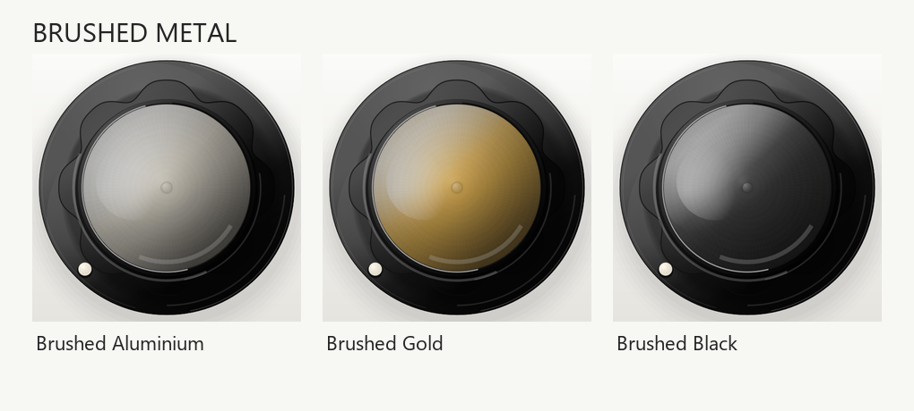

```cpp
laf.setMetalFinish (KnobMetalFinish::gold);
// or any juce::Colour:
laf.setMetalColour (juce::Colour (0xffd3a64c));
```

The metal finishes are enumerated by `getKnobMetalFinishes()` for a selector.
Neve-Basic has no metal part, so these settings do not apply to it.

## Use

```cpp
#include "Knobs/BossSkirtedLookAndFeel.h"   // or BossLookAndFeel.h / BossKnobs.h

BossSkirtedLookAndFeel laf;
laf.setStyle (BossKnobLookAndFeel::Style::topDown);
slider.setLookAndFeel (&laf);
```

Or create a named model from the family:

```cpp
#include "Knobs/BossKnobs.h"

auto laf = makeBossLookAndFeel (BossModel::boss);          // no skirt, black
auto skirted = makeBossLookAndFeel (BossModel::bossSkirted,
                                    KnobFinish::vintageCream,
                                    KnobMetalFinish::gold);
```

Set the LAF on the editor so all child sliders inherit it. Keep the LAF member
before the sliders and clear it with `setLookAndFeel (nullptr)` in the editor
destructor. The demo editor uses `BossLookAndFeel`; changing its member type to
`BossSkirtedLookAndFeel` switches the whole panel to the skirted model.

Neve-Basic is used the same way:

```cpp
#include "Knobs/NeveBasicLookAndFeel.h"

NeveBasicLookAndFeel neve;
neve.setPlasticFinish (KnobFinish::vintageOxblood);
slider.setLookAndFeel (&neve);
```

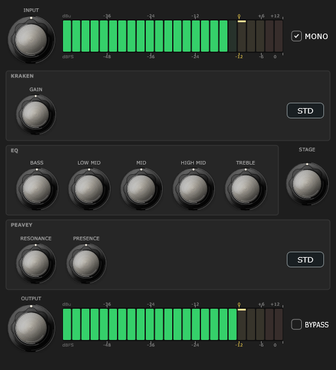

## Previewing

`NamForgeKnobShot` renders three large instances and accepts the model, style,
plastic finish and metal finish:

```powershell
& ..\build-vst\NamForgeKnobShot_artefacts\Release\NamForgeKnobShot.exe '..\build-vst\boss-red.png' boss-skirted topdown modern-red aluminium
& ..\build-vst\NamForgeKnobShot_artefacts\Release\NamForgeKnobShot.exe '..\build-vst\boss-cream-gold.png' boss topdown vintage-cream gold
& ..\build-vst\NamForgeKnobShot_artefacts\Release\NamForgeKnobShot.exe '..\build-vst\neve.png' neve-basic topdown vintage-oxblood
& ..\build-vst\NamForgeKnobShot_artefacts\Release\NamForgeKnobShot.exe '..\build-vst\marconi.png' neve-marconi topdown black
& ..\build-vst\NamForgeKnobShot_artefacts\Release\NamForgeKnobShot.exe '..\build-vst\fender.png' fender topdown black
& ..\build-vst\NamForgeKnobShot_artefacts\Release\NamForgeKnobShot.exe '..\build-vst\rectifier-silver.png' rectifier topdown none silver
& ..\build-vst\NamForgeKnobShot_artefacts\Release\NamForgeKnobShot.exe '..\build-vst\rectifier-gold.png' rectifier topdown none gold
& ..\build-vst\NamForgeKnobShot_artefacts\Release\NamForgeKnobShot.exe '..\build-vst\rectifier-black.png' rectifier topdown none black
& ..\build-vst\NamForgeKnobShot_artefacts\Release\NamForgeKnobShot.exe '..\build-vst\ssl.png' ssl topdown modern-blue
& ..\build-vst\NamForgeKnobShot_artefacts\Release\NamForgeKnobShot.exe '..\build-vst\ssl-cren.png' ssl-crenulated topdown modern-blue
& ..\build-vst\NamForgeKnobShot_artefacts\Release\NamForgeKnobShot.exe '..\build-vst\api.png' api topdown black
```

The full editor render:

```powershell
& ..\build-vst\NamForgeUiShot_artefacts\Release\NamForgeUiShot.exe '..\build-vst\ui-knob.png'
```
