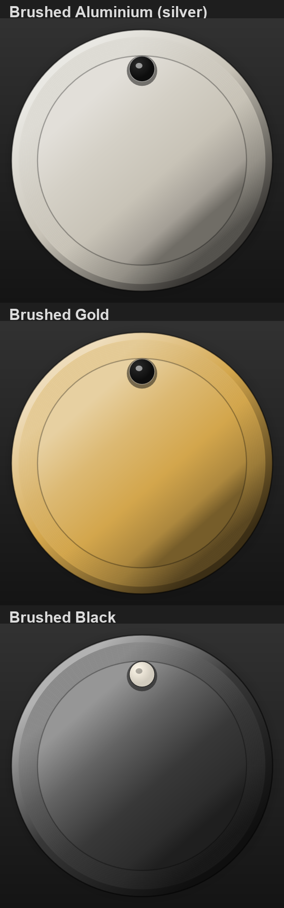

# Rectifier knob

The Rectifier is the skirtless metal knob in the classic set. It deliberately
does **not** use the plastic palette: the whole body is brushed metal and the
palette is the metal finish set.



## Design

- **No skirt or plastic grip.** The body is a single brushed disc with a
  machined bevel; there is no outer flange or knurled plastic ring.
- **Metal finishes only:** Brushed Aluminium (silver), Brushed Gold and Brushed
  Black. These are `KnobMetalFinish` values from
  [`KnobColours.h`](../vst/Source/Knobs/KnobColours.h).
- **Large position dot.** A large dot sits on the knob angle, near the edge of
  the top face. It is **black on silver/gold** and **white on brushed black**,
  chosen from the metal brightness, with a contrast ring and specular highlight.
- The old chrome dome and gold set screw are gone; the set screw was not a
  position indicator.
- Straight-on/axial only, like the rest of the classic set.

## Code

[`RectifierLookAndFeel.h`](../vst/Source/Knobs/RectifierLookAndFeel.h):

```cpp
RectifierLookAndFeel knob;
knob.setMetalFinish (KnobMetalFinish::gold);   // aluminium | gold | black
// or an arbitrary base metal colour:
knob.setMetalColour (juce::Colour (0xffb8b8b8));
```

The class intentionally has no `setPlasticFinish`/`setPlasticColour` API.

## Rendering

`NamForgeKnobShot` takes the metal finish in the last argument; the plastic
finish argument is ignored for Rectifier (use `none` as a placeholder):

```powershell
$exe = '..\build-vst\NamForgeKnobShot_artefacts\Release\NamForgeKnobShot.exe'
& $exe '..\build-vst\rectifier-silver.png' rectifier topdown none silver
& $exe '..\build-vst\rectifier-gold.png'   rectifier topdown none gold
& $exe '..\build-vst\rectifier-black.png'  rectifier topdown none black
```

Each image shows the knob at minimum, centre and maximum. The palette sheet
above stacks the three finishes.
