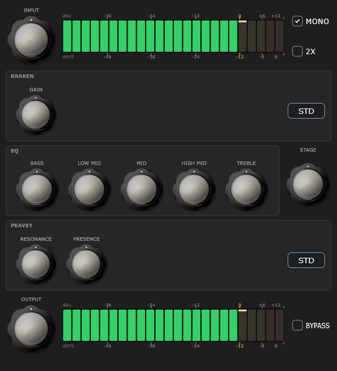
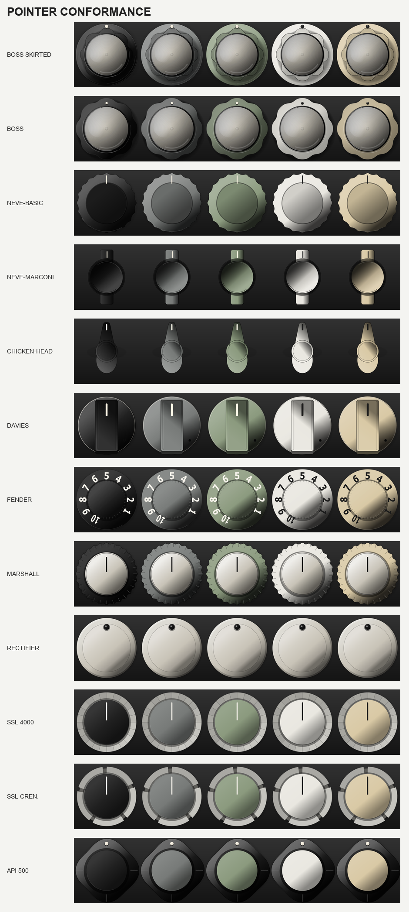

# Test Plugin Style Guide

**Applies to:** every Nam Forge test/demo plugin (`vst/` targets).
**Derived from:** the Kraken → Peavey demo, which is the reference implementation.
**Reference source:** [../vst/Source](../vst/Source) — see
[LedMeter.h](../vst/Source/LedMeter.h) and the
[Boss knob library](../vst/Source/Knobs).



A test plugin exists to validate models and listen to them, not to ship. It must
be quick to build, honest about what it does, and look the same as every other
test plugin so muscle memory carries between them.

---

## 1. Minimum feature set

### MUST

| # | Feature | Notes |
|---|---|---|
| 1 | **Input gain** knob | −24..+24 dB, default 0, smoothed ~25 ms |
| 2 | **Input meter** | Horizontal LED, tapped **post input gain**, pre-model |
| 3 | **Output gain** knob | −24..+24 dB, default 0, smoothed ~25 ms |
| 4 | **Output meter** | Horizontal LED, tapped **post output gain**, final output |
| 5 | **Mono / Stereo** switch | Default **Mono**; halves CPU; no auto-detection |
| 6 | **Bypass** switch | Fully dry passthrough; meters read silence |
| 7 | **Quality** switch per model that has a quality pair | Binary, default Standard |
| 8 | **Inter-stage gain** knob per stage boundary | Placed per §3 |
| 9 | 48 kHz enforcement | Non-48 kHz → silence + visible notice |
| 10 | Latency reported honestly | `setLatencySamples(0)` by default; if oversampling is present, report the exact constant PDC |
| 11 | No allocation in the audio callback | Split oversized blocks |
| 12 | Parameter state save/restore | Via `AudioProcessorValueTreeState` |
| 13 | **Fixed safety filters**, no UI | 10 Hz DC block pre- and post-model; 19 kHz fourth-order low-pass on the output. Transparent in the passband, no latency |

### MUST NOT

- No file loading, training code, or HISE dependency.
- No numeric readout under knobs (it costs horizontal space the meters need).
- No branding, preset browser, or extra meters.
- No undeclared or hidden resampling. A plugin may omit oversampling; if it has
  it, the mode must be explicit, bypassable and PDC-reported.
- No silent resampling: refuse rather than fake 48 kHz.

The Kraken -> Peavey demo is the reference implementation and now includes an
optional **global 2x** oversampler (49-sample PDC, constant Off/2x). New test
plugins may keep the simpler 1x/zero-latency path; the template still does. If
you add oversampling, follow the demo's constant-PDC rule and add a self-test
check for the measured impulse.

### SHOULD

- An **inter-stage EQ insert** when the plugin has two or more stages: five
  musical bands (bass shelf, low mid, mid, high mid, treble shelf) at ±6 dB,
  default 0. Place it and the inter-stage gain per §3.
- An offline self-test asserting every parameter reaches the DSP (§7).
- A headless editor render for visual checks (§7).

---

## 2. Standard layout

Fixed vertical stack. Reference size **560 × 616**, min ~420 × 300.

```
┌──────────────────────────────────────────────────────────────┐
│ [INPUT]   ▮▮▮▮▮▮▮▮▮▮▮▮▯▯▯▯▯▯▯▯▯▯▯▯▯▯▯          [ MONO ]    │
│  knob      dBu ▔▔▔▔▔ meter ▔▔▔▔▔ dBFS         switch         │
├──────────────────────────────────────────────────────────────┤
│  STAGE 1                                                     │
│    [params…]                            [ ECO | STD ]        │
├──────────────────────────────────────────────────────────────┤
│  EQ                                        STAGE              │
│    [BASS] [LOW] [MID] [HIGH] [TREBLE]      [STAGE] knob       │
├──────────────────────────────────────────────────────────────┤
│  STAGE 2                                                     │
│    [params…]                            [ ECO | STD ]        │
├──────────────────────────────────────────────────────────────┤
│ [OUTPUT]  ▮▮▮▮▮▮▮▮▮▮▮▮▯▯▯▯▯▯▯▯▯▯▯▯▯▯▯        [ BYPASS ]    │
│  knob      dBu ▔▔▔▔▔ meter ▔▔▔▔▔ dBFS         switch         │
└──────────────────────────────────────────────────────────────┘
```

Rules:

- **Top row** is always Input + meter + Mono. **Bottom row** is always
  Output + meter + Bypass. They are mirror images.
- **One bordered panel per model stage**, in signal order, titled with the model
  name in uppercase.
- **Quality switches are right-aligned in their stage row**, and their x
  positions **line up vertically across all stage rows**.
- Knob labels sit above the knob, uppercase, 10 px.
- An inter-stage insert (the five-band EQ) gets its **own panel between the two
  model rows**, and the inter-stage gain sits at the **end of that row** — see §3.

---

## 3. Inter-stage gain placement (explicit)

> **Every inter-stage gain knob terminates the inter-stage chain: it is the last
> control after the insert, and it stays in the same right-hand column as the
> quality switches.**

```
│  KRAKEN                                                      │
│    [GAIN] knob                            [ ECO | STD ]      │
├──────────────────────────────────────────────────────────────┤
│  EQ                                       STAGE              │
│    [BASS] [LOW] [MID] [HIGH] [TREBLE]     [STAGE] knob       │
```

- The gain belongs to the **output** of that stage — it trims what feeds the
  next stage. Draw it in the stage it leaves, not the stage it enters.
- It is the **last control of the inter-stage chain**. Two cases:
  - **No insert:** it sits immediately left of that stage's quality button,
    forming a right-aligned group. Do not give it its own row.
  - **With an insert** (EQ, filter, saturation): the insert gets its own panel
    between the two model rows, and the gain sits at the **end of the insert
    row**, right-aligned under the quality column so the chain reads
    model → insert → gain → next model.
- Either way it stays in the same right-hand column as the quality buttons, so
  the column is consistent down the editor.
- If a stage has no quality switch (static model), place the inter-stage gain
  in the same right-aligned column where that stage's quality button would be.
- A plugin with three stages therefore has two inter-stage gains, each in the
  row of the stage it follows.
- Label it `STAGE` (or `STAGE 1`, `STAGE 2` when there are several).

Rationale: stage trims and quality switches are both "set and forget" controls
about the stage, while the model's axes are the musical controls. Grouping them
keeps the musical knobs on the left and the plumbing on the right.

---

## 4. Parameter conventions

- **Continuous → knob. Binary → switch.** No dropdowns, no combo boxes.
- Model axes use the model's own range and default (for example `0..10`,
  default 5). Pass the raw value to `setModelParam`; the core clamps it.
- Quality is a **bool** parameter: `false = Eco`, `true = Standard`, default
  `true`. Button text is `STD` / `ECO`.
- Mono and Bypass are bools; Mono defaults **on**, Bypass **off**.
- Parameter IDs are lowerCamelCase and stable: `input`, `output`, `mono`,
  `bypass`, `stageLevel`, `<model>Quality`, `<model><Axis>`.

---

## 5. Visual style

### Colours

| Element | Value |
|---|---|
| Editor background | `0xff1e1e1e` |
| Stage panel fill | `0xff262626` |
| Stage panel border | `0xff3c3c3c`, 1 px, 4 px radius |
| Panel title | `0xff8f8f8f`, 10 px bold, uppercase |
| Knob label | `0xffb4b4b4`, 10 px, uppercase |
| Status / warning text | `0xffe8c84a` |
| Meter bar background | `0xff101010` |

### Knobs — Boss family

Fluted black body, spun-aluminium cap and a white position dot, **no value
readout**. Use the shared library in `Source/Knobs`:

- `BossSkirtedLookAndFeel` — wide gloss-plastic skirt, eight-lobed body and
  aluminium cap (the reference reconstruction).
- `BossLookAndFeel` — the same body and cap without the skirt; the fluted body
  is the outer diameter and the dot sits on its black top ring.
- Both default to `Style::topDown` (axial, rack-panel view). The skirted model
  also supports `Style::perspective`.
- **The demo and the scaffold use `BossLookAndFeel` (non-skirted) by default.**
  Use `BossSkirtedLookAndFeel` only when the wide skirt is wanted.
- Plastic finishes come from `KnobColours.h`: modern (red, blue, green, purple,
  yellow, orange), vintage (oxblood, royal blue, sage green, grey, cream), plus
  Black and White. Black is the default.
- The aluminium cap has its own brushed finish: aluminium, gold or black.
- `NeveBasicLookAndFeel` is the straight-on fluted plastic knob with a recessed
  top and radial pointer; it has no metal cap.
- `NeveMarconiLookAndFeel` is the straight-on Marconi knob with a central cap
  and pointer bar; it omits the reference object's clear skirt.
- Classic references: `ChickenHeadLookAndFeel`, `DaviesLookAndFeel`,
  `FenderLookAndFeel` (descending 10→1 numbers with 5 centred; no text or
  pointer; bold white markers except on White and Cream), `MarshallLookAndFeel`
  and `RectifierLookAndFeel`. Console additions: `SSLLookAndFeel`,
  `SSLCrenulatedLookAndFeel` and `APILookAndFeel`.
- Every new knob model must ship with a full thirteen-colour contact sheet:
  Black, White, the six modern colours and the five vintage colours. The
  **Rectifier is the exception**: it is metal-only and ships the three-finish
  silver/gold/brushed-black sheet instead.

Implement once and set it on the **editor** so all children inherit it. Call
`setLookAndFeel(nullptr)` in the editor destructor and declare the LAF member
**before** the sliders so it outlives them.

### Pointers and indicators (MUST)

Every knob with a separate pointer, dot, stripe or index must read the knob's
**current position**, not decorate it:

- The pointer rotates with the knob. At the standard 7:30–4:30 travel it points
  to **12 o'clock at centre**, **7:30 at minimum** and **4:30 at maximum**.
  A fixed or decorative offset is not acceptable.
- Dot pointers sit on the knob's angle at their stated radius; line/stripe
  pointers run radially outward from the hub.
- Pointer colour follows the knob **body/plinth**: warm white **`#FFF8E8`** on
  every body colour except **White** (`#E9E7E0`) and **Cream** (`#D9C9A5`),
  which use charcoal **`#1B1B1B`**. Inserts and recesses are accents and do not
  change the pointer colour; the API body is always black, so its dot stays
  white even with a White/Cream insert.
- Metal-surface exception: a pointer/index sitting on a metal finish is
  **black `#111111` on silver/aluminium and gold**, and **warm white `#FFF8E8`
  on brushed black**. Use a contrasting edge for legibility.
- Shape and size may vary by model. Placement, rotation and colour may not.
- Fender is the no-pointer exception (numbers only). Chicken-Head's body forms
  the pointer, but its index line follows this rule.



### Metrics

| Item | Value |
|---|---|
| Editor padding | 10 px |
| Global row height | 100 px |
| Stage row height | 126 px |
| Vertical gap | 8 px |
| Knob column | 84 px wide; knob is a centred square of `min(w, h)` |
| Knob label band | 13 px |
| Quality button | 62 × 26 px |
| Mode / bypass button | 68 × 26 px |
| Stage panel inner padding | 8 px, 16 px title band |

---

## 6. Level meters

One shared `LedMeter` class for both meters, so appearance and kinetics are
identical by construction.

**Appearance**

- 24 discrete segments, horizontal, 1 px gaps, 1.5 px radius.
- Unlit: near-black, 18% alpha of the segment colour.
- Green ≤ −12 dBFS, amber −12..−3 dBFS, red > −3 dBFS.
- Scale spans −60 dBFS (left) to 0 dBFS (right).

**Dual scale**

- **dBu on top, dBFS underneath.**
- `0 dBFS = +12 dBu` → dBu = dBFS + 12; 0 dBu sits at −12 dBFS.
- Highlight the 0 dBu tick.
- Ticks at 0, −6, −12, −24, −36, −48 dBFS (+12, +6, 0, −12, −24, −36 dBu).
- `dBu` / `dBFS` unit hints at the left; 9 px text.

**Kinetics** (identical for both meters)

- Peak detection, instant attack, ~300 ms release (20 dB per 300 ms).
- Peak hold 1.5 s, then falls at 12 dB/s.
- 60 Hz repaint, driven from the audio thread through atomics.
- `setActive(false)` while bypassed → reads silence.

**Taps**

| Meter | Tapped at |
|---|---|
| Input | after input gain, before the first model |
| Output | after output gain, at the final output |

---

## 7. Verification (recommended for every test plugin)

Both checks run without a DAW and should gate any build handed over.

1. **Parameter self-test** — instantiate the processor, drive a sine, assert
   every parameter changes the audio in the expected direction, that bypass is
   dry, and that mono/stereo behave. Catch the classic "the knob moves but
   nothing happens" (a `SmoothedValue` that never receives `setTargetValue`).
2. **Headless editor render** — snapshot the editor to PNG to check layout,
   knob rendering and meter scale without launching a host. Write to a **new
   filename each run**: re-rendering to the same path has served stale content
   on this machine.

Reference targets: `NamForgeSelfTest`, `NamForgeUiShot` in
[../vst/CMakeLists.txt](../vst/CMakeLists.txt).

---

## 8. Reuse checklist for a new test plugin

Start from the scaffold rather than copying by hand:

```powershell
pwsh -File tools\New-TestPlugin.ps1 -Name "NamForge Foo Demo"
```

That generates `vst\<Target>` from [../vst/template](../vst/template) with the
frame, parameters, meters, self-test and UI renderer already wired, and the
placeholder stages marked for replacement. Use `-Target`, `-PluginCode` or
`-BundleId` to override the derived metadata.

The checklist below is what the scaffold guarantees — use it to review a plugin
that was not generated, or after heavy edits.

- [ ] Copy `LedMeter.h`, `Knobs/` (Boss family and Neve-Basic), `FiveBandEq.h`
      and `SafetyFilters.h` into the new `Source/`.
- [ ] Copy the editor shell: top row, stage panels, EQ row, bottom row,
      560 × 616.
- [ ] Input gain + meter on top; output gain + meter on the bottom.
- [ ] Mono switch top-right, Bypass bottom-right.
- [ ] One panel per stage, in signal order, titled uppercase.
- [ ] EQ insert in its own panel between the model rows, five bands ±6 dB.
- [ ] Every inter-stage gain at the **end of the EQ row**, right-aligned under
      the quality column; quality switches aligned across rows.
- [ ] Continuous → knob, binary → switch; no numeric readouts.
- [ ] Meters use the shared `LedMeter`; dBu top / dBFS bottom, 0 dBFS = 12 dBu.
- [ ] 48 kHz enforced, honest latency (0 by default, constant PDC if
      oversampling), no allocation, block splitting.
- [ ] Safety filters in place: DC block before and after the models, 19 kHz
      low-pass on the output; no controls for them.
- [ ] Self-test passes (including one check per EQ band); editor render looks right.
